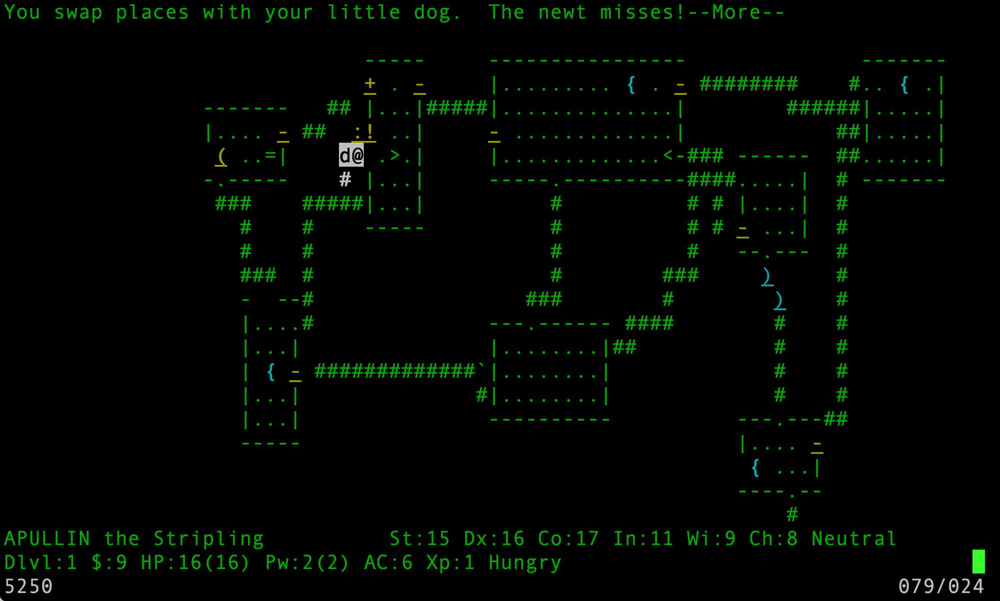

# NetHack 3.6.7 for IBM AS/400 (or IBM i System)

NetHack 3.6.7 on the AS/400, played on a 5250 display in color:

It builds and plays in two ways:

- **PASE**: the stock Unix build, compiled with gcc in IBM i's AIX runtime and played
  over SSH with the curses or tty interface.
- **Native ILE C**: the game as an IBM i program, played over SSH, or on a 5250 display
  (the green screen): type `NETHACK` at a command line.

The game itself is unchanged. The port is `include/ibmiconf.h`, `sys/ibmi/`,
`sys/unix/hints/pase` and `ibmi/`, plus small changes in 13 upstream files, each marked
"Changed for IBM i". [ibmi/README.md](../ibmi/README.md) says how to build and play;
[ibmi/DESIGN.md](../ibmi/DESIGN.md) is the design log. Tested on IBM i 7.5
([PUB400.COM](https://pub400.com)).

This is not an official NetHack release. Report problems with it here, not to the
NetHack DevTeam. NetHack's own [README](../README) and [license](../dat/license) apply.

This is a fork from a much older version of NetHack, 3.6.7 (2023), with all the
platform-specific modifications added. Everything that differs from 3.6.7 as released:
`git diff NetHack-3.6.7_Released`.
